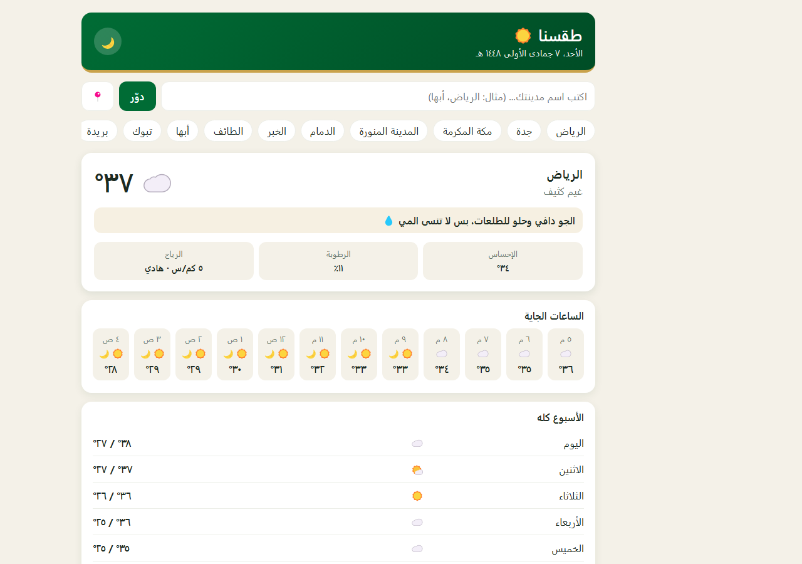

# طقسنا ☀️

تطبيق طقس خفيف يركّز على مدن السعودية، بواجهة عربية RTL ولهجة سعودية، بدون أي مفتاح API ولا تسجيل حساب. مبني بـ HTML + CSS + JavaScript خالص.



## وش فيه

- ١٤ مدينة سعودية جاهزة كـ "chips" سريعة (الرياض، جدة، مكة، المدينة، الدمام، أبها، تبوك... وغيرها).
- بحث عن أي مدينة بالاسم، أو استخدام موقعك الحالي.
- حالة الجو الحالية: الحرارة، الوصف، الإحساس، الرطوبة، الرياح.
- نصيحة بلهجة سعودية حسب الجو ("الجو دافي وحلو للطلعات، بس لا تنسى المي 💧").
- توقعات الساعات الجاية، وتوقعات الأسبوع كامل.
- وضع ليلي/نهاري.

## التشغيل

```bash
npx serve .
# أو
python3 -m http.server 8000
```
بعدها افتح `index.html` مباشرة أو من السيرفر المحلي.

## التقنيات

- **Vanilla JavaScript**: طبقة اتصال بالـ API منفصلة (`js/weather-api.js`) عن منطق الواجهة (`js/app.js`).
- **Open-Meteo API** للطقس والبحث عن المدن — مجاني بالكامل وبدون أي مفتاح API.
- `async/await` مع معالجة أخطاء، وحفظ آخر مدينة بحثت عنها.

## الفكرة والمصدر

الفكرة العامة (تطبيق طقس) مستوحاة من مشاريع مفتوحة المصدر برخصة MIT على GitHub. الكود هنا مكتوب من جديد، مع تركيز كامل على المدن السعودية.
